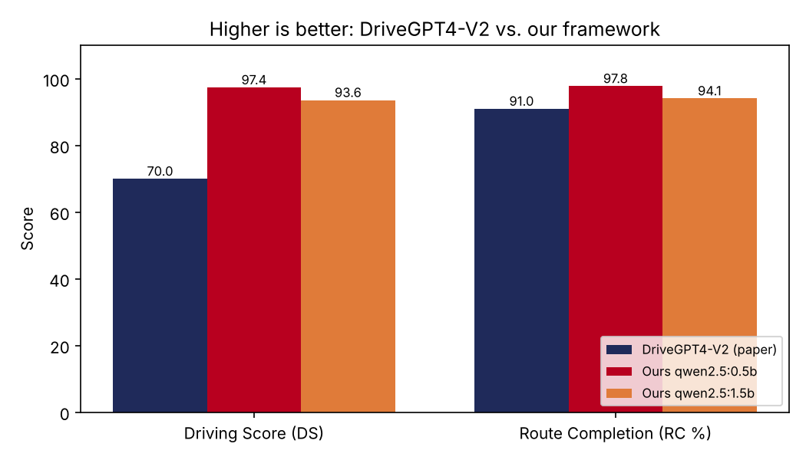

# Autonomous Driving with Sensor Fusion and LLM Decision-Making (CARLA 0.9.16 + Ollama)

**Author:** Vivek Chakali, B.E. Electronics and Communication Engineering

A closed-loop autonomous driving framework that fuses LiDAR, radar, IMU and GNSS data, asks a local LLM (served by Ollama) for high-level driving decisions, and passes every decision through a deterministic safety layer before it reaches the vehicle controllers. Evaluation follows the DriveGPT4-V2 (CVPR 2025) metrics: Driving Score DS = RC x IS, where RC is route completion and IS the infraction score.

## System block diagram


The diagram is the one embedded in slide 8 of the seminar: sensor inputs, synchronisation, fusion, scene representation, LLM reasoning, safety validation, waypoint generation, trajectory control, embedded actuation, and the vehicle in CARLA or on the prototype.

## Architecture

| Layer | Files | Role |
|---|---|---|
| Sensing and fusion | `sensor_rig.py`, `perception_processor.py`, `ad_world.py` | LiDAR (32 channels), radar, IMU, GNSS and collision sensors; objects are expressed in the route (Frenet) frame and fused into a single gap estimate |
| LLM decision | `ad_llm.py`, `prompt_builder.py`, `llm_planner.py`, `drivegpt4_v2.py` | Compact prompt, JSON reply with target speed, target angle and waypoints; keep-alive HTTP to Ollama; newest prompt wins |
| Behaviour planning | `ad_planner.py`, `lane_change_planner.py`, `maneuver_arbiter.py` | Car following, crossing and cut-in prediction, traffic-light stops, own-lane-first overtakes, opposite lane only when needed, reverse recovery |
| Safety | `safety_filter.py`, `rss_safety_shield.py`, `autonomous_rules_engine.py`, `ambiguity_detector.py` | Rejects or modifies unsafe commands using collision checks, lane limits, speed limits and minimum-distance rules |
| Control | `ad_control.py`, `pid_controller.py` | Speed PID and steering PID with a speed-dependent look-ahead |
| DAgger authority | `ad_llm.py` (`DaggerArbiter`) | Switches between LLM control and expert takeover when the LLM output is unsafe or too slow (threshold 6 km/h) |
| Scenarios and runner | `run_test_cases.py`, `extra_scenarios.py`, `drive_in_carla.py`, `run_all_tests.py` | 100 test cases (TC_01 to TC_100), interactive tour mode, batch mode |
| Metrics and reports | `ad_metrics.py`, `leaderboard_metrics.py`, `analyze_all_csvs.py`, `benchmark_llm_comparison.py` | DS, RC, IS, collision and red-light classification, per-case CSV logs, Markdown comparison report |
| Offline tests | `offline_planner_tests.py`, `offline_test_runner.py` | 37 closed-loop planner tests with a kinematic simulator (no CARLA needed) |
| Hardware bridge (prototype) | `hardware_bridge.py` | Interface sketch for passing actuator commands to an embedded controller |

## Requirements

- Windows 10/11 (the launcher is PowerShell), Python 3.10 or newer.
- CARLA 0.9.16 simulator, installed separately (not part of this repository).
- Ollama, with a model pulled, for example `ollama pull qwen2.5:0.5b`.
- Laptop used for development: AMD Ryzen 7 7735HS, 16 GB RAM, NVIDIA RTX 3050 (6 GB VRAM). CARLA and the LLM share the GPU, so the LLM may fall back to CPU if VRAM is tight.
- Python packages: see `requirements.txt`.

## Quick start

```powershell
# Interactive demo: runs all test cases in order at real-time speed, with tour mode
.\start_drive.ps1 -Demo -Model qwen2.5:0.5b

# Batch run of all test cases (writes the CSV and Markdown reports)
.\start_drive.ps1 -Batch -Model qwen2.5:0.5b

# Run a range of test cases only
.\start_drive.ps1 -Batch -From 1 -To 20 -Model qwen2.5:0.5b

# Fast (non-real-time) mode for quick regression runs
.\start_drive.ps1 -Batch -Fast -Model qwen2.5:0.5b

# Planner tests without CARLA
python offline_planner_tests.py
```

`start_drive.ps1` starts Ollama before CARLA so that the model is loaded on the GPU first. Use `-OllamaCPU` only for debugging.

### Interactive keys (drive_in_carla.py)

| Key | Action |
|---|---|
| N / P | Next / previous test case |
| R | Restart the current test case |
| M or TAB | Toggle manual / AI mode |
| L | Toggle LLM on or off |
| C | Cycle the LLM authority (dagger, advisory, expert) |
| T | Toggle tour mode (auto-advance) |
| G | Pause or resume |
| B | Show or hide the HUD |
| Q | Quit |
| ESC | Quit the current run |

## Test cases

The 100 test cases cover: clear lanes and cruising; static obstacles and bypasses; cut-ins by cars, bicycles and motorcycles; leading vehicles that brake hard or stop and go; pedestrians (walking, running, standing, crossing in groups, at night and in rain); traffic lights (red stop, green pass, yellow, green-to-red, red-to-green, red with a queue, red during a lane change); junction turns; oncoming traffic and wrong-way drivers; road works, cones and barriers; weather and night; and a few mixed-rule validation cases. Each case has a scripted start, an expected outcome and a logged result in `results/ai/result_TC_<nn>_<NAME>_AI.csv` (LLM-assisted) or `results/manual/result_TC_<nn>_<NAME>_MANUAL.csv` (manual driving).

## Results (latest run, 100 test cases per model)

| Metric | qwen2.5:0.5b | qwen2.5:1.5b | DriveGPT4-V2 (paper, Longest6) |
|---|---|---|---|
| Driving Score (DS) | 97.4 | 93.6 | 70 |
| Route Completion (%) | 97.8 | 94.1 | 91 |
| Infraction Score (IS) | 1.00 | 0.99 | 0.77 |
| Pedestrian collisions per episode | 0.00 | 0.00 | 0.00 |
| Vehicle collisions per episode | 0.01 | 0.01 | 0.80 |
| Red-light violations per episode | 0.00 | 0.00 | 0.04 |
| LLM reply time (mean, replies received) | about 0.48 s | about 1.07 s | n/a |
| LLM share of control steps | 1.3 % | 1.9 % | n/a |

These are short scripted CARLA scenarios and are not directly comparable with the paper's 36 Longest6 routes. The one vehicle collision per model is test case TC_09 (wrong-way oncoming car), recorded before the latest brake-on-oncoming fix. Full tables are in `reports/LLM_Comparison_Report.md` and `reports/drivegpt4_v2_paper_metrics_v2.csv`.

Per-test-case numbers are in `reports/drivegpt4_v2_paper_metrics_v2.csv`; the aggregate comparison below is generated from that file.

## Experimental results (from the seminar, updated with the latest run)

### Results table

| Test case | DS | RC (%) | IS | LLM latency (ms) | DAgger (%) | Primary failure mode |
|---|---|---|---|---|---|---|
| TC_02 Static obstacle (0.5b) | 100.0 | 100.0 | 1.00 | 444 | 2.2 | None (latency flag only) |
| TC_03 Rain + obstacle (0.5b) | 100.0 | 100.0 | 1.00 | 521 | 82.5 | None (speed flag only) |
| TC_09 Wrong-way oncoming (0.5b) | 60.0 | 100.0 | 0.60 | - | 0.0 | 1 vehicle collision |
| TC_13 Tight corridor (0.5b) | 1.27 | 1.3 | 1.00 | - | 0.0 | Blocked, no safe path |
| **Mean, 100 cases, qwen2.5:0.5b** | **97.4** | **97.8** | **1.00** | **477** | **2.6** | - |
| **Mean, 100 cases, qwen2.5:1.5b** | **93.6** | **94.1** | **0.99** | **1074** | **2.6** | - |

Safety counts over 100 cases per model: 0 pedestrian collisions, 0 red-light violations, and 1 vehicle collision (TC_09, logged before the brake-on-oncoming fix). The "Blocked" and "timeout" cases are TC_13 (by design) and TC_79 (0.5b) or TC_66 and TC_79 (1.5b).

### Comparison with the base paper

| Metric | DriveGPT4-V2 (paper) | Ours 0.5b | Ours 1.5b |
|---|---|---|---|
| DS ↑ | 70 | 97.4 | 93.6 |
| RC (%) ↑ | 91 | 97.8 | 94.1 |
| IS ↑ | 0.77 | 1.00 | 0.99 |
| Pedestrian collisions ↓ | 0.00 | 0.00 | 0.00 |
| Vehicle collisions ↓ | 0.80 | 0.01 | 0.01 |
| Static collisions ↓ | 0.01 | 0.00 | 0.01 |
| Red-light violations ↓ | 0.04 | 0.00 | 0.00 |
| Route deviations ↓ | 0.00 | 0.00 | 0.03 |
| Timeouts ↓ | 0.07 | 0.01 | 0.00 |
| Agent blocks ↓ | 0.09 | 0.01 | 0.04 |



*Indicative only: the paper reports 36 long Longest6 routes (infraction values are event ratios), while ours are 100 short scripted CARLA scenarios (values are events per episode). Paper values are from Table 2 of Xu et al., CVPR 2025.*

### Key observations

- **Safety first.** No pedestrian or red-light events across 200 episodes. IS is 1.00 for 0.5b and 0.99 for 1.5b, against 0.77 for DriveGPT4-V2.
- **Cautious, not collision-prone.** The lowest scores come from the TC_13 tight corridor (blocked) and from runs ended early by the operator, not from infractions. Red-light holds (TC_47, TC_49, TC_50, TC_52, TC_54) count as valid waits.
- **Planner layer dominates the outcome.** The LLM drove only 1.3% (0.5b) and 1.9% (1.5b) of control steps, and DAgger took over 2.6% of steps. The 0.5b vs 1.5b gap comes from blocked or skipped episodes, not model-driven infractions.
- **Latency is the bottleneck.** LLM replies took 0.34–0.62 s (0.5b) and 0.70–1.98 s (1.5b), a decision rate of 0.14 Hz and 0.07 Hz against a 20 Hz control loop. The LLM therefore works as an advisory layer, and faster or distilled models are needed.

### Conclusion and future scope

**Conclusion.** An LLM-assisted closed-loop driving framework was built and evaluated in CARLA 0.9.16 using the DriveGPT4-V2 metrics. Its best model, qwen2.5:0.5b, reached DS 97.4, RC 97.8% and IS 1.00, with no pedestrian or red-light events. The open issues are one wrong-way collision (TC_09), the TC_13 block and LLM latency of 0.3–2 s.

**Future scope.** Benchmark on CARLA Longest6 / Town05 Long for a like-for-like comparison with the base paper; re-run all 100 cases with the latest planner fixes; reduce LLM latency with GPU inference and distilled models; and move to a Jetson + MCU prototype with LiDAR/ToF, radar, IMU and GNSS fusion.

### Aggregate comparison (generated from the same CSV)

| Model | Episodes | Mean DS | Mean RC % | Mean IS | Pedestrian coll. | Vehicle coll. | Red-light viol. | Blocked / timeout per 100 | Mean LLM reply (ms) |
|---|---|---|---|---|---|---|---|---|---|
| qwen2.5:0.5b | 100 | 97.4 | 97.8 | 1.00 | 0 | 1 | 0 | 2 | 477 |
| qwen2.5:1.5b | 100 | 93.6 | 94.1 | 0.99 | 0 | 1 | 0 | 3 | 1074 |
| DriveGPT4-V2 (paper, Longest6) | 36 routes | 70 | 91 | 0.77 | 0.00 | 0.80 | 0.04 | 0.16 | n/a |

## Metrics and parameters glossary

### Scoring metrics (DriveGPT4-V2 / CARLA leaderboard)

| Metric | Meaning | How to read it |
|---|---|---|
| **DS (Driving Score)** | DS = RC × IS. The main overall score, 0–100. | Higher is better. A full route with no infractions scores 100. |
| **RC (Route Completion %)** | Percentage of the scripted route the car covered before the episode ended. | Higher is better. Low values mean the car got stuck, blocked or timed out. |
| **IS (Infraction Score)** | Product of penalty factors, one per infraction. 1.00 means no infractions. | TC_09 has IS 0.60 from one vehicle collision, so DS = 100 × 0.60 = 60. |
| **Ped penalty 0.50** | Factor for each pedestrian collision. | Multiplies IS by 0.50. |
| **Veh penalty 0.60** | Factor for each vehicle collision. | Multiplies IS by 0.60. |
| **Stat penalty 0.65** | Factor for hitting a static object (cone, barrier, parked car). | Multiplies IS by 0.65. |
| **Red penalty 0.70** | Factor for each red-light violation (crossing the stop line on red). | Multiplies IS by 0.70. |
| **Ped / Veh / Stat / Red counts** | Number of each infraction per episode. | Should be 0. |
| **Dev (Route deviation)** | Times the car left the planned route. | Should be 0. |
| **TO (Timeout)** | Fraction of episodes that reached `AD_EPISODE_TIMEOUT_S` (70 s) before finishing. | Lower is better. A timeout on TC_50 is expected, since it is a deliberate hold. |
| **Block** | Fraction of episodes ended as `blocked`: accumulated blocked time reached `AD_BLOCK_LIMIT_S` (30 s) without a valid reason. | Lower is better. Legitimate waits (red light, queue, yield, closed road, junction) don't count. |
| **Hold OK** | For test cases that expect a deliberate stop (TC_10, 31, 47, 49, 50, 52, 54), whether the hold happened as designed. | 1 = correct hold. The episode ends as `hold_completed` after the car has been stopped for `AD_HOLD_DONE_S` (15 s). |
| **End reason** | Why the episode ended. | `route_completed`, `hold_completed`, `timeout`, `blocked`, or `user_skip` (you pressed N). A `user_skip` run is incomplete, so its score isn't comparable with a finished run. |

### Driving and timing metrics

| Metric | Meaning |
|---|---|
| **Sim time (s)** | Simulated time for the episode. |
| **Distance (m)** | Distance travelled along the route. |
| **Avg speed (km/h)** | Mean speed over the episode. |
| **Sim FPS** | Simulation steps per real second. The simulator runs at 20 Hz (DT = 0.05 s). |
| **L1 speed error (km/h)** | Mean absolute difference between the speed requested by the LLM or planner and the speed the car actually reached. Lower means the controller follows targets closely. |
| **LLM mean latency (ms)** | Average time from sending a prompt to Ollama until the reply arrives. Reported only for episodes where the LLM replied. |
| **LLM Hz** | Effective decision rate: new LLM decisions per second. 0.14 Hz means one decision about every 7 s. |
| **LLM control %** | Share of control steps driven by the LLM's output. The rest came from the planner or expert. |
| **DAgger takeover %** | Share of steps where the arbiter overrode the LLM and used the expert instead. |
| **Primary failure mode** | Main issue flagged for the run. `LLM_NOT_READY` means no LLM reply had arrived yet, which is normal at the start. `FAIL_LATENCY` means replies arrived too late. `FAIL_UNSAFE_SPEED` means the speed exceeded what the planner allowed. |

### Runtime parameters (config.py)

**Speed and comfort**

| Parameter | Value | Meaning |
|---|---|---|
| `AD_CRUISE_KMH` | 30 | Urban speed limit used by the expert. |
| `AD_JUNCTION_KMH` | 22 | Speed limit inside junctions. |
| `AD_WEATHER_CAP_KMH` | clear 30, wet 26, rain 24, heavy rain 20, fog 18 | Speed caps by weather. |
| `AD_HEADWAY_S` | 1.2 | Time gap kept behind a moving vehicle (scaled by road friction when wet). |
| `AD_COMFORT_DECEL` | 2.8 m/s² | Comfortable braking the planner uses when slowing or stopping. |
| `AD_MAX_DECEL` | 7.5 m/s² | Maximum braking, used for emergency braking (AEB). |

**Waiting and bypass decisions**

| Parameter | Value | Meaning |
|---|---|---|
| `AD_STATIC_CONFIRM_S` | 1.2 | A parked object must be seen this long before the car may bypass it. |
| `AD_STATIC_STANDSTILL_M` | 10.0 | Distance kept behind a static obstacle, leaving room to steer around it. |
| `AD_TRAFFIC_STOP_CONFIRM_S` | 4.0 | A vehicle that was moving and then stopped is treated as traffic, so the car waits this long before bypassing. |
| `AD_VRU_PATIENCE_S` | 10.0 | A pedestrian or animal standing in the lane is waited for this long, then bypassed. |
| `AD_QUEUE_PATIENCE_S` | 30 | Maximum wait in a stationary queue. |

**LLM interface**

| Parameter | Value | Meaning |
|---|---|---|
| `AD_LLM_AUTHORITY` | dagger | Who has control: `dagger` (LLM with expert takeover), `advisory` (LLM only suggests), or `expert` (rule-based expert only). |
| `AD_DAGGER_THRESHOLD_KMH` | 6.0 | If the LLM's speed differs from the expert's by more than this, the expert takes over and the sample is logged to `dagger_dataset.jsonl`. |
| `AD_LLM_PERIOD_S` | 0.5 | A new prompt is sent every 0.5 s, with one request in flight at a time. |
| `AD_LLM_MAX_AGE_S` | 2.0 | An LLM decision older than this is ignored. |
| `AD_LLM_TIMEOUT_S` | 6.0 | Maximum wait for a reply before the request is abandoned. |
| `AD_LLM_NUM_PREDICT` | 40 | Maximum tokens generated per reply (about 25 are needed for the JSON). Keeps latency low. |
| `AD_LLM_NUM_CTX` | 1024 | Context window. The prompt is about 250 tokens, so it is never truncated. |

**Episode control and scoring**

| Parameter | Value | Meaning |
|---|---|---|
| `AD_ROUTE_TARGET_M` | 150 | Route length that counts as 100% route completion. |
| `AD_EPISODE_TIMEOUT_S` | 70 | Time limit per episode. |
| `AD_BLOCK_LIMIT_S` | 30 | Accumulated blocked time that ends the episode as `blocked`. |
| `AD_HOLD_DONE_S` | 15 | Time a deliberate hold must last to end the episode as `hold_completed`. |

### Planner terms

- **Own lane first.** Overtakes use your own lane. The opposite lane is used only when your lanes are blocked and no oncoming traffic is present.
- **Bypass candidates, ranked 0–3.** 0 is a nudge within your own lane, 1 is the centre of your lane, 2 is straddling a lane line, and 3 is the opposite lane. The planner tries them in that order.
- **Reverse recovery.** The car reverses only when very close to an obstacle, and it checks behind before moving.
- **EVADE mode.** Used when a wrong-way vehicle approaches. The car brakes or moves aside based on time-to-collision (TTC).
- **Need-crawl and need-normal gaps.** Minimum gaps the planner requires before it squeezes past an obstacle at crawl speed or at normal speed.

## Known limitations

- LLM latency (0.3 to 2 s per reply) is too slow for direct vehicle control, so the LLM works as an advisory layer and the planner drives most of the time.
- Route completion is lower on the rain-plus-obstacle overtake case because the planner declines some overtakes in traffic.
- Results come from a simulator on one laptop; no on-road testing has been done.

## Documentation

- `docs/presentation/Project_Seminar_Vivek_Chakali.pptx` - project seminar slides (Abstract Level Presentation).
- `docs/images/block_diagram.png` - system block diagram (slide 8 of the seminar).
- `docs/abstract/Project_Seminar_Abstract.docx` - project abstract (B.E. VII Sem, Project Seminar 2026-27).
- `docs/base_paper/DriveGPT4-V2_CVPR2025_Xu_et_al.pdf` - the base paper: Xu et al., "DriveGPT4-V2", CVPR 2025.
- `PROJECT_FIXES_v20.md` - change log (v20 to v26), base-paper parameter table and command cheat sheet.
- `reports/LLM_Comparison_Report.md` - latest model comparison and per-case table.

## License

Academic project. Add a license before reusing the code.
