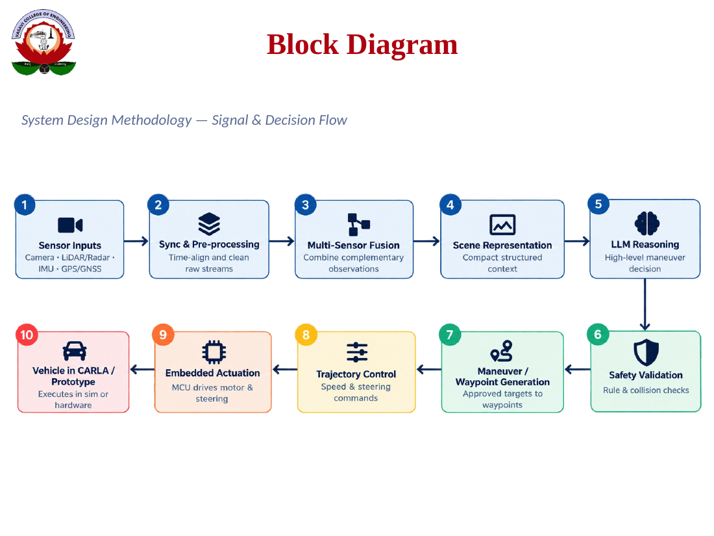

# Autonomous Driving with Sensor Fusion and LLM Decision-Making (CARLA 0.9.16 + Ollama)

**Author:** Vivek Chakali, B.E. Electronics and Communication Engineering (final year), Vasavi College of Engineering (Autonomous), Hyderabad.

A closed-loop autonomous driving framework that fuses LiDAR, radar, IMU and GNSS data, asks a local LLM (served by Ollama) for high-level driving decisions, and passes every decision through a deterministic safety layer before it reaches the vehicle controllers. Evaluation follows the DriveGPT4-V2 (CVPR 2025) metrics: Driving Score DS = RC x IS, where RC is route completion and IS the infraction score.

## System block diagram



The block diagram follows the seminar's signal and decision flow: sensor acquisition, synchronisation and fusion, scene representation, LLM manoeuvre generation, safety validation, trajectory control and actuation, with evaluation against a baseline.

## Architecture

| Layer | Files | Role |
|---|---|---|
| Sensing and fusion | `sensor_rig.py`, `perception_processor.py`, `ad_world.py` | LiDAR (32 channels), radar, IMU, GNSS and collision sensors; objects are expressed in the route (Frenet) frame and fused into a single gap estimate |
| LLM decision | `ad_llm.py`, `prompt_builder.py`, `llm_planner.py`, `drivegpt4_v2.py` | Compact prompt, JSON reply with target speed, target angle and waypoints; keep-alive HTTP to Ollama; newest prompt wins |
| Behaviour planning | `ad_planner.py`, `lane_change_planner.py`, `maneuver_arbiter.py` | Car following, crossing and cut-in prediction, traffic-light stops, own-lane-first overtakes, opposite lane only when needed, reverse recovery |
| Safety | `safety_filter.py`, `rss_safety_shield.py`, `autonomous_rules_engine.py`, `ambiguity_detector.py` | Rejects or modifies unsafe commands using collision checks, lane limits, speed limits and minimum-distance rules |
| Control | `ad_control.py`, `pid_controller.py` | Speed PID and steering PID with a speed-dependent look-ahead |
| DAgger authority | `ad_llm.py` (`DaggerArbiter`) | Switches between LLM control and expert takeover when the LLM output is unsafe or too slow (threshold 6 km/h) |
| Scenarios and runner | `run_test_cases.py`, `extra_scenarios.py`, `drive_in_carla.py`, `run_all_tests.py` | 100 test cases (TC_01 to TC_100), interactive tour mode, batch mode |
| Metrics and reports | `ad_metrics.py`, `leaderboard_metrics.py`, `analyze_all_csvs.py`, `benchmark_llm_comparison.py` | DS, RC, IS, collision and red-light classification, per-case CSV logs, Markdown comparison report |
| Offline tests | `offline_planner_tests.py`, `offline_test_runner.py` | 37 closed-loop planner tests with a kinematic simulator (no CARLA needed) |
| Hardware bridge (prototype) | `hardware_bridge.py` | Interface sketch for passing actuator commands to an embedded controller |

## Requirements

- Windows 10/11 (the launcher is PowerShell), Python 3.10 or newer.
- CARLA 0.9.16 simulator, installed separately (not part of this repository).
- Ollama, with a model pulled, for example `ollama pull qwen2.5:0.5b`.
- Laptop used for development: AMD Ryzen 7 7735HS, 16 GB RAM, NVIDIA RTX 3050 (6 GB VRAM). CARLA and the LLM share the GPU, so the LLM may fall back to CPU if VRAM is tight.
- Python packages: see `requirements.txt`.

## Quick start

```powershell
# Interactive demo: runs all test cases in order at real-time speed, with tour mode
.\start_drive.ps1 -Demo -Model qwen2.5:0.5b

# Batch run of all test cases (writes the CSV and Markdown reports)
.\start_drive.ps1 -Batch -Model qwen2.5:0.5b

# Run a range of test cases only
.\start_drive.ps1 -Batch -From 1 -To 20 -Model qwen2.5:0.5b

# Fast (non-real-time) mode for quick regression runs
.\start_drive.ps1 -Batch -Fast -Model qwen2.5:0.5b

# Planner tests without CARLA
python offline_planner_tests.py
```

`start_drive.ps1` starts Ollama before CARLA so that the model is loaded on the GPU first. Use `-OllamaCPU` only for debugging.

### Interactive keys (drive_in_carla.py)

| Key | Action |
|---|---|
| N / P | Next / previous test case |
| R | Restart the current test case |
| M or TAB | Toggle manual / AI mode |
| L | Toggle LLM on or off |
| C | Cycle the LLM authority (dagger, advisory, expert) |
| T | Toggle tour mode (auto-advance) |
| G | Pause or resume |
| B | Show or hide the HUD |
| Q | Quit |
| ESC | Quit the current run |

## Test cases

The 100 test cases cover: clear lanes and cruising; static obstacles and bypasses; cut-ins by cars, bicycles and motorcycles; leading vehicles that brake hard or stop and go; pedestrians (walking, running, standing, crossing in groups, at night and in rain); traffic lights (red stop, green pass, yellow, green-to-red, red-to-green, red with a queue, red during a lane change); junction turns; oncoming traffic and wrong-way drivers; road works, cones and barriers; weather and night; and a few mixed-rule validation cases. Each case has a scripted start, an expected outcome and a logged result in `results/ai/result_TC_<nn>_<NAME>_AI.csv` (LLM-assisted) or `results/manual/result_TC_<nn>_<NAME>_MANUAL.csv` (manual driving).

## Results (latest run, 100 test cases per model)

| Metric | qwen2.5:0.5b | qwen2.5:1.5b | DriveGPT4-V2 (paper, Longest6) |
|---|---|---|---|
| Driving Score (DS) | 97.4 | 93.6 | 70 |
| Route Completion (%) | 97.8 | 94.1 | 91 |
| Infraction Score (IS) | 1.00 | 0.99 | 0.77 |
| Pedestrian collisions per episode | 0.00 | 0.00 | 0.00 |
| Vehicle collisions per episode | 0.01 | 0.01 | 0.80 |
| Red-light violations per episode | 0.00 | 0.00 | 0.04 |
| LLM reply time (mean, replies received) | about 0.48 s | about 1.07 s | n/a |
| LLM share of control steps | 1.3 % | 1.9 % | n/a |

These are short scripted CARLA scenarios and are not directly comparable with the paper's 36 Longest6 routes. The one vehicle collision per model is test case TC_09 (wrong-way oncoming car), recorded before the latest brake-on-oncoming fix. Full tables are in `reports/LLM_Comparison_Report.md` and `reports/drivegpt4_v2_paper_metrics_v2.csv`.

### Per-test-case results (generated from `reports/drivegpt4_v2_paper_metrics_v2.csv`, latest run per case)

| Test case | DS 0.5b | DS 1.5b | RC % (0.5b / 1.5b) | Vehicle coll. (0.5b / 1.5b) | End reason (0.5b / 1.5b) |
|---|---|---|---|---|---|
| `TC_01_CLEAR_LANE` | 100.0 | 100.0 | 100.0 / 100.0 | 0 / 0 | route_completed / route_completed |
| `TC_02_STATIC_OBSTACLE` | 100.0 | 100.0 | 100.0 / 100.0 | 0 / 0 | route_completed / route_completed |
| `TC_03_RAIN_AND_OBSTACLE` | 100.0 | 100.0 | 100.0 / 100.0 | 0 / 0 | route_completed / route_completed |
| `TC_04_URBAN_JAYWALKER` | 100.0 | 100.0 | 100.0 / 100.0 | 0 / 0 | route_completed / route_completed |
| `TC_05_SEMI_RURAL_ENCROACH` | 100.0 | 100.0 | 100.0 / 100.0 | 0 / 0 | route_completed / route_completed |
| `TC_06_RURAL_SLOW_TRUCK` | 100.0 | 100.0 | 100.0 / 100.0 | 0 / 0 | route_completed / route_completed |
| `TC_07_2WHEELER_CUT_IN` | 100.0 | 100.0 | 100.0 / 100.0 | 0 / 0 | route_completed / route_completed |
| `TC_08_NIGHT_VISION_LIMIT` | 100.0 | 100.0 | 100.0 / 100.0 | 0 / 0 | route_completed / route_completed |
| `TC_09_WRONG_WAY_ONCOMING` | 60.0 | 60.0 | 100.0 / 100.0 | 1 / 1 | route_completed / route_completed |
| `TC_100_TOTAL_AUTONOMY_GRAND_CHALLENGE` | 100.0 | 100.0 | 100.0 / 100.0 | 0 / 0 | route_completed / route_completed |
| `TC_10_HEAVY_FOG_GRIDLOCK` | 100.0 | 100.0 | 100.0 / 100.0 | 0 / 0 | route_completed / route_completed |
| `TC_11_ERRATIC_ANIMAL` | 100.0 | 100.0 | 100.0 / 100.0 | 0 / 0 | route_completed / route_completed |
| `TC_12_SUN_GLARE` | 100.0 | 100.0 | 100.0 / 100.0 | 0 / 0 | route_completed / route_completed |
| `TC_13_TIGHT_CORRIDOR` | 1.27 | 1.27 | 1.3 / 1.3 | 0 / 0 | blocked / blocked |
| `TC_14_CROSS_TRAFFIC` | 100.0 | 100.0 | 100.0 / 100.0 | 0 / 0 | route_completed / route_completed |
| `TC_15_CHAOTIC_MIXED` | 100.0 | 100.0 | 100.0 / 100.0 | 0 / 0 | route_completed / route_completed |
| `TC_16_TRAFFIC_SIGNAL_STOP` | 100.0 | 100.0 | 100.0 / 100.0 | 0 / 0 | route_completed / route_completed |
| `TC_17_PEDESTRIAN_CROWD` | 100.0 | 100.0 | 100.0 / 100.0 | 0 / 0 | route_completed / route_completed |
| `TC_18_ANIMAL_CROSSING` | 100.0 | 100.0 | 100.0 / 100.0 | 0 / 0 | route_completed / route_completed |
| `TC_19_DENSE_TRAFFIC_CONGESTION` | 100.0 | 100.0 | 100.0 / 100.0 | 0 / 0 | route_completed / route_completed |
| `TC_20_ADVERSE_WEATHER` | 100.0 | 100.0 | 100.0 / 100.0 | 0 / 0 | route_completed / route_completed |
| `TC_21_AMBIGUOUS_INTERSECTION` | 100.0 | 100.0 | 100.0 / 100.0 | 0 / 0 | route_completed / route_completed |
| `TC_22_OCCLUDED_PEDESTRIAN` | 100.0 | 100.0 | 100.0 / 100.0 | 0 / 0 | route_completed / route_completed |
| `TC_23_SIMULTANEOUS_CROSSING` | 59.08 | 100.0 | 59.1 / 100.0 | 0 / 0 | user_skip / route_completed |
| `TC_24_CONFLICTING_SIGNALS` | 100.0 | 100.0 | 100.0 / 100.0 | 0 / 0 | route_completed / route_completed |
| `TC_25_SUDDEN_LEAD_BRAKE` | 47.5 | 100.0 | 47.5 / 100.0 | 0 / 0 | user_skip / route_completed |
| `TC_26_LOW_VISIBILITY_MIXED` | 100.0 | 100.0 | 100.0 / 100.0 | 0 / 0 | route_completed / route_completed |
| `TC_27_LEAD_SLOW_CRUISE` | 100.0 | 100.0 | 100.0 / 100.0 | 0 / 0 | route_completed / route_completed |
| `TC_28_LEAD_HARD_BRAKE_CLOSE` | 100.0 | 100.0 | 100.0 / 100.0 | 0 / 0 | route_completed / route_completed |
| `TC_29_LEAD_STOP_AND_GO` | 100.0 | 100.0 | 100.0 / 100.0 | 0 / 0 | route_completed / route_completed |
| `TC_30_PLATOON_FOLLOW` | 100.0 | 100.0 | 100.0 / 100.0 | 0 / 0 | route_completed / route_completed |
| `TC_31_STATIONARY_QUEUE` | 100.0 | 100.0 | 100.0 / 100.0 | 0 / 0 | route_completed / route_completed |
| `TC_32_STOPPED_TRUCK_IN_LANE` | 100.0 | 100.0 | 100.0 / 100.0 | 0 / 0 | route_completed / route_completed |
| `TC_33_CUT_IN_NEAR` | 100.0 | 100.0 | 100.0 / 100.0 | 0 / 0 | route_completed / route_completed |
| `TC_34_CUT_IN_AT_SPEED` | 100.0 | 100.0 | 100.0 / 100.0 | 0 / 0 | route_completed / route_completed |
| `TC_35_BICYCLE_CUT_IN` | 100.0 | 100.0 | 100.0 / 100.0 | 0 / 0 | route_completed / route_completed |
| `TC_36_MOTORCYCLE_CUT_IN` | 100.0 | 100.0 | 100.0 / 100.0 | 0 / 0 | route_completed / route_completed |
| `TC_37_PARKED_ROW_RIGHT_LANE` | 100.0 | 100.0 | 100.0 / 100.0 | 0 / 0 | route_completed / route_completed |
| `TC_38_DOUBLE_PARKED_TRUCK` | 100.0 | 100.0 | 100.0 / 100.0 | 0 / 0 | route_completed / route_completed |
| `TC_39_JAYWALK_WALKING` | 100.0 | 100.0 | 100.0 / 100.0 | 0 / 0 | route_completed / route_completed |
| `TC_40_JAYWALK_RUNNING` | 100.0 | 100.0 | 100.0 / 100.0 | 0 / 0 | route_completed / route_completed |
| `TC_41_CHILD_DART_BETWEEN_PARKED` | 100.0 | 100.0 | 100.0 / 100.0 | 0 / 0 | route_completed / route_completed |
| `TC_42_PED_STANDING_ROADSIDE` | 100.0 | 100.0 | 100.0 / 100.0 | 0 / 0 | route_completed / route_completed |
| `TC_43_PED_GROUP_CROSSING` | 100.0 | 100.0 | 100.0 / 100.0 | 0 / 0 | route_completed / route_completed |
| `TC_44_PED_STOPS_IN_LANE` | 100.0 | 100.0 | 100.0 / 100.0 | 0 / 0 | route_completed / route_completed |
| `TC_45_PED_NIGHT_CROSSING` | 100.0 | 100.0 | 100.0 / 100.0 | 0 / 0 | route_completed / route_completed |
| `TC_46_PED_RAIN_CROSSING` | 100.0 | 100.0 | 100.0 / 100.0 | 0 / 0 | route_completed / route_completed |
| `TC_47_RED_LIGHT_STOP` | 100.0 | 100.0 | 100.0 / 100.0 | 0 / 0 | hold_completed / user_skip |
| `TC_48_GREEN_LIGHT_PASS` | 100.0 | 8.54 | 100.0 / 8.5 | 0 / 0 | route_completed / user_skip |
| `TC_49_YELLOW_STOPPABLE` | 100.0 | 100.0 | 100.0 / 100.0 | 0 / 0 | hold_completed / user_skip |
| `TC_50_GREEN_TO_RED` | 100.0 | 15.72 | 100.0 / 15.7 | 0 / 0 | hold_completed / user_skip |
| `TC_51_RED_TO_GREEN_RESUME` | 100.0 | 100.0 | 100.0 / 100.0 | 0 / 0 | route_completed / route_completed |
| `TC_52_RED_WITH_QUEUE` | 100.0 | 100.0 | 100.0 / 100.0 | 0 / 0 | hold_completed / route_completed |
| `TC_53_GREEN_PED_ON_APPROACH` | 100.0 | 100.0 | 100.0 / 100.0 | 0 / 0 | route_completed / route_completed |
| `TC_54_RED_NIGHT_RAIN` | 100.0 | 100.0 | 100.0 / 100.0 | 0 / 0 | hold_completed / route_completed |
| `TC_55_RIGHT_TURN_CLEAR` | 100.0 | 100.0 | 100.0 / 100.0 | 0 / 0 | route_completed / route_completed |
| `TC_56_LEFT_TURN_CLEAR` | 100.0 | 100.0 | 100.0 / 100.0 | 0 / 0 | route_completed / route_completed |
| `TC_57_LEFT_TURN_ONCOMING` | 100.0 | 100.0 | 100.0 / 100.0 | 0 / 0 | route_completed / route_completed |
| `TC_58_RIGHT_TURN_SLOW_LEAD` | 100.0 | 100.0 | 100.0 / 100.0 | 0 / 0 | route_completed / route_completed |
| `TC_59_STRAIGHT_THROUGH_JUNCTION` | 100.0 | 100.0 | 100.0 / 100.0 | 0 / 0 | route_completed / route_completed |
| `TC_60_ONCOMING_NORMAL_PASS` | 100.0 | 100.0 | 100.0 / 100.0 | 0 / 0 | route_completed / route_completed |
| `TC_61_ONCOMING_WITH_PARKED_CAR` | 100.0 | 100.0 | 100.0 / 100.0 | 0 / 0 | route_completed / route_completed |
| `TC_62_ONCOMING_TRUCK` | 100.0 | 100.0 | 100.0 / 100.0 | 0 / 0 | route_completed / route_completed |
| `TC_63_CONE_CHICANE` | 100.0 | 100.0 | 100.0 / 100.0 | 0 / 0 | route_completed / route_completed |
| `TC_64_BARRIER_FULL_BLOCK` | 100.0 | 100.0 | 100.0 / 100.0 | 0 / 0 | route_completed / route_completed |
| `TC_65_SMALL_DEBRIS` | 100.0 | 100.0 | 100.0 / 100.0 | 0 / 0 | route_completed / route_completed |
| `TC_66_ROADWORK_ZONE` | 100.0 | 5.9 | 100.0 / 5.9 | 0 / 0 | route_completed / blocked |
| `TC_67_NIGHT_STATIC_CAR` | 100.0 | 100.0 | 100.0 / 100.0 | 0 / 0 | route_completed / route_completed |
| `TC_68_FOG_STATIC_CAR` | 100.0 | 100.0 | 100.0 / 100.0 | 0 / 0 | route_completed / route_completed |
| `TC_69_HEAVY_RAIN_LEAD_BRAKE` | 100.0 | 100.0 | 100.0 / 100.0 | 0 / 0 | route_completed / route_completed |
| `TC_70_GLARE_SLOW_LEAD` | 100.0 | 100.0 | 100.0 / 100.0 | 0 / 0 | route_completed / route_completed |
| `TC_71_WET_ROAD_PED_CROSSING` | 100.0 | 100.0 | 100.0 / 100.0 | 0 / 0 | route_completed / route_completed |
| `TC_72_DUSK_CYCLIST_AHEAD` | 100.0 | 100.0 | 100.0 / 100.0 | 0 / 0 | route_completed / route_completed |
| `TC_73_HIGH_SPEED_CLOSING` | 100.0 | 100.0 | 100.0 / 100.0 | 0 / 0 | route_completed / route_completed |
| `TC_74_SPEED_LIMIT_CRUISE` | 100.0 | 100.0 | 100.0 / 100.0 | 0 / 0 | route_completed / route_completed |
| `TC_75_NO_ROOM_TO_MOVE` | 100.0 | 100.0 | 100.0 / 100.0 | 0 / 0 | route_completed / route_completed |
| `TC_76_RUSH_HOUR_MIXED` | 100.0 | 100.0 | 100.0 / 100.0 | 0 / 0 | route_completed / route_completed |
| `TC_77_LEAD_BRAKE_PLUS_PED` | 100.0 | 100.0 | 100.0 / 100.0 | 0 / 0 | route_completed / route_completed |
| `TC_78_STORM_NIGHT_CROSSING` | 100.0 | 100.0 | 100.0 / 100.0 | 0 / 0 | route_completed / route_completed |
| `TC_79_MIXED_RULES_VALIDATION` | 76.06 | 36.73 | 76.1 / 36.7 | 0 / 0 | timeout / blocked |
| `TC_80_EMERGENCY_VEHICLE_APPROACH` | 100.0 | 100.0 | 100.0 / 100.0 | 0 / 0 | route_completed / route_completed |
| `TC_81_BLIND_SPOT_MERGE_VEHICLE` | 100.0 | 100.0 | 100.0 / 100.0 | 0 / 0 | route_completed / route_completed |
| `TC_82_CONSTRUCTION_LANE_DROP_MERGE` | 100.0 | 100.0 | 100.0 / 100.0 | 0 / 0 | route_completed / route_completed |
| `TC_83_DOORING_BICYCLIST_HAZARD` | 100.0 | 100.0 | 100.0 / 100.0 | 0 / 0 | route_completed / route_completed |
| `TC_84_CROSSWALK_Z_WALKER_RETREAT` | 100.0 | 100.0 | 100.0 / 100.0 | 0 / 0 | route_completed / route_completed |
| `TC_85_SCHOOL_BUS_EXTENDED_STOP` | 100.0 | 100.0 | 100.0 / 100.0 | 0 / 0 | route_completed / route_completed |
| `TC_86_WHEELCHAIR_CROSSING` | 100.0 | 100.0 | 100.0 / 100.0 | 0 / 0 | route_completed / route_completed |
| `TC_87_MOTORCYCLE_FILTERING_SPLITTING` | 100.0 | 100.0 | 100.0 / 100.0 | 0 / 0 | route_completed / route_completed |
| `TC_88_CARRIER_TRUCK_OVERHANG_CARGO` | 100.0 | 100.0 | 100.0 / 100.0 | 0 / 0 | route_completed / route_completed |
| `TC_89_FALLEN_TREE_BRANCH_OBSTACLE` | 100.0 | 100.0 | 100.0 / 100.0 | 0 / 0 | route_completed / route_completed |
| `TC_90_SLIPPERY_OIL_SLICK_AQUAPLANING` | 100.0 | 100.0 | 100.0 / 100.0 | 0 / 0 | route_completed / route_completed |
| `TC_91_TUNNEL_LIGHT_TRANSITION` | 100.0 | 100.0 | 100.0 / 100.0 | 0 / 0 | route_completed / route_completed |
| `TC_92_FREEWAY_ON_RAMP_MERGE` | 100.0 | 100.0 | 100.0 / 100.0 | 0 / 0 | route_completed / route_completed |
| `TC_93_UNPROTECTED_LEFT_TURN_GAP` | 100.0 | 100.0 | 100.0 / 100.0 | 0 / 0 | route_completed / route_completed |
| `TC_94_REVERSING_OUT_OF_DRIVEWAY` | 100.0 | 100.0 | 100.0 / 100.0 | 0 / 0 | route_completed / route_completed |
| `TC_95_DOUBLE_PARKED_DELIVERY_VAN` | 100.0 | 100.0 | 100.0 / 100.0 | 0 / 0 | route_completed / route_completed |
| `TC_96_HIGHWAY_GHOST_DRIVER_DODGE` | 100.0 | 100.0 | 100.0 / 100.0 | 0 / 0 | route_completed / route_completed |
| `TC_97_CROSS_TRAFFIC_INTERSECTION_RUNNER` | 100.0 | 100.0 | 100.0 / 100.0 | 0 / 0 | route_completed / route_completed |
| `TC_98_MULTI_PEDESTRIAN_ZEBRA_SURGE` | 100.0 | 100.0 | 100.0 / 100.0 | 0 / 0 | route_completed / route_completed |
| `TC_99_CONE_SLALOM_WORKZONE` | 100.0 | 100.0 | 100.0 / 100.0 | 0 / 0 | route_completed / route_completed |

### Aggregate comparison (generated from the same CSV)

| Model | Episodes | Mean DS | Mean RC % | Mean IS | Pedestrian coll. | Vehicle coll. | Red-light viol. | Blocked / timeout per 100 | Mean LLM reply (ms) |
|---|---|---|---|---|---|---|---|---|---|
| qwen2.5:0.5b | 100 | 97.4 | 97.8 | 1.00 | 0 | 1 | 0 | 2 | 477 |
| qwen2.5:1.5b | 100 | 93.6 | 94.1 | 0.99 | 0 | 1 | 0 | 3 | 1074 |
| DriveGPT4-V2 (paper, Longest6) | 36 routes | 70 | 91 | 0.77 | 0.00 | 0.80 | 0.04 | 0.16 | n/a |

## Known limitations

- LLM latency (0.3 to 2 s per reply) is too slow for direct vehicle control, so the LLM works as an advisory layer and the planner drives most of the time.
- Route completion is lower on the rain-plus-obstacle overtake case because the planner declines some overtakes in traffic.
- Results come from a simulator on one laptop; no on-road testing has been done.

## Documentation

- `docs/presentation/Project_Seminar_Vivek_Chakali.pptx` - project seminar slides (Abstract Level Presentation).
- `docs/images/slides/` - each seminar slide rendered as a PNG (`slide_01.png` to `slide_16.png`), including the block diagrams on slides 3, 4, 9, 10, 11 and 14.
- `docs/images/embedded/` - pictures and logos embedded in the slides.
- `docs/base_paper/DriveGPT4-V2_CVPR2025_Xu_et_al.pdf` - the base paper: Xu et al., "DriveGPT4-V2", CVPR 2025.
- `PROJECT_FIXES_v20.md` - change log (v20 to v26), base-paper parameter table and command cheat sheet.
- `reports/LLM_Comparison_Report.md` - latest model comparison and per-case table.

## License

Academic project. Add a license before reusing the code.
